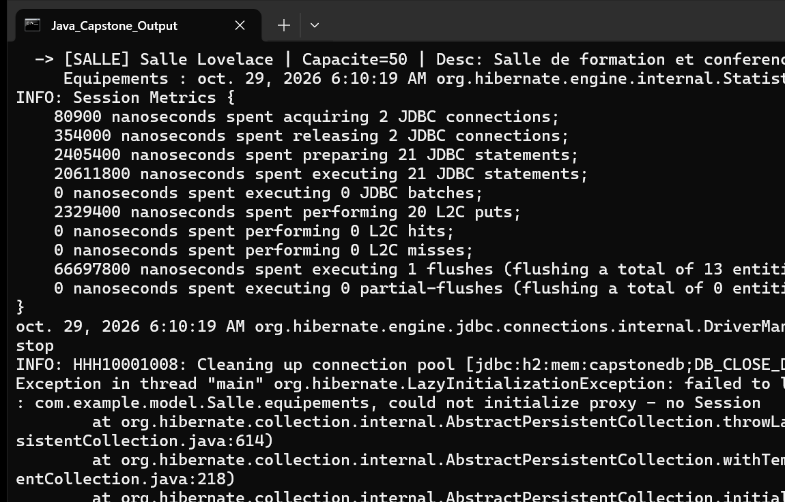

# TP Capstone : Finalisation de l'Application "Réservation de Salles"

Projet intégrateur final (Capstone) du cursus Hibernate & JPA. Il synthétise l'ensemble des compétences acquises : modélisation relationnelle riche, migration de schéma SQL, verrouillage optimiste avec gestion de concurrence multi-threads, cache de second niveau (L2) Ehcache, et reporting de performance.

## Architecture et Composants Réalisés

### 1. Modélisation du Domaine Métier
- **`Utilisateur` :** Entité représentant les usagers du système (`id`, `nom`, `prenom`, `email` unique), annotée avec `@Version` pour la détection des conflits et `@Cacheable` pour le cache L2.
- **`Equipement` :** Matériels audiovisuels et informatiques affectables aux salles (`nom`), gérés en cache de second niveau.
- **`Salle` :** Salles réservables (`nom`, `capacite`, `description`), associées en N:N avec `Equipement` via la table de jointure `salle_equipement`, et en 1:N avec `Reservation` (`orphanRemoval = true`).
- **`Reservation` :** Intervalle temporel (`dateDebut`, `dateFin`), `motif`, `statut` (`CONFIRMEE`, `ANNULEE`), clé de concurrence `@Version`, reliée en `@ManyToOne` à `Salle` et `Utilisateur`.

### 2. Outil de Migration de Schéma SQL
- **Script :** `db/migration/v2_0_add_description.sql`
- **Composant :** `com.example.migration.DatabaseMigrationTool`
- **Actions :** Sauvegarde des tables existantes (`backup_utilisateurs`, `backup_reservations`), ajout de la colonne `description` sur `salles`, création de l'index unique `idx_utilisateur_email`, ajout de la contrainte d'intégrité `CHECK (date_fin > date_debut)`, et purge automatique des réservations obsolètes annulées.

### 3. Concurrence Multi-Threads & Verrouillage Optimiste
- **Composant :** `com.example.service.ReservationService`
- **Scénario :** Simulation de deux threads concurrents synchronisés par un `CountDownLatch`.
- **Résolution :** Détection de l'exception `OptimisticLockException` sur la transaction concurrente et résolution automatique via le mécanisme de rejeu (`modifierAvecRetry`) avec rechargement de l'entité fraîche et incrémentation finale de version.

### 4. Rapport de Performance & Cache L2 Ehcache
- **Composant :** `com.example.util.PerformanceReport`
- **Métriques :** Extraction des statistiques de session (`Statistics`) : comptage des requêtes SQL, durée maximale d'exécution, hits/misses/puts du cache L2, et calcul du taux de succès (hit ratio).
- **Moteur de Recommandations :** Diagnostic automatique alertant en cas de risque de requêtes N+1 et vérification de l'efficacité du cache de second niveau.

## Exécution et Tests

### Commandes Maven
Exécution de la suite de tests unitaires JUnit :
```bash
mvn clean test
```

Lancement de la démonstration intégrale :
```bash
mvn clean compile exec:java -Dexec.mainClass="com.example.App"
```

## Résultat d'Exécution

La capture ci-dessous illustre la console lors de l'exécution de l'application `com.example.App`.



### Description de la Capture
- En-tête : Démarrage du projet Capstone sur l'unité de persistance `ReservationPU`.
- Module 1 : Application sans erreur du script de migration SQL `v2_0_add_description.sql` (création des tables de backup, index unique et contrainte CHECK).
- Module 2 : Initialisation réussie des entités de base (équipements, salles avec équipements, utilisateurs et réservations).
- Module 3 : Recherche et affichage des salles disponibles pour un créneau avec leurs équipements associés.
- Module 4 : Démonstration du verrouillage optimiste avec 2 threads concurrents synchronisés par `CountDownLatch`, interception de l'erreur de version et résolution automatique via retry aboutissant à la mise à jour finale.
- Module 5 : Génération du rapport de performance complet avec métriques Ehcache L2 et validation des recommandations d'optimisation.
- Clôture réussie sans exception.
